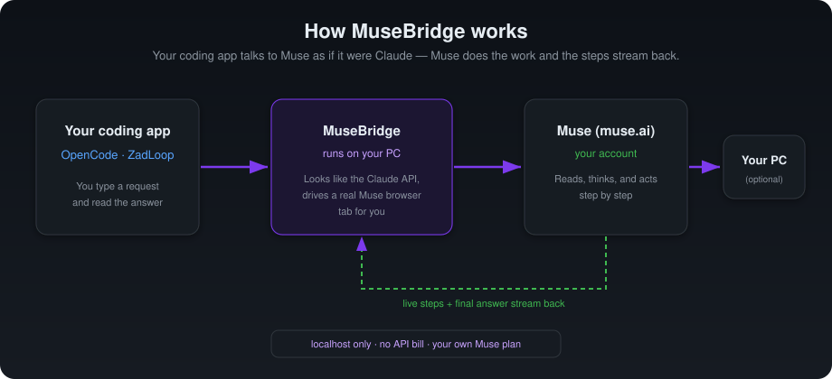
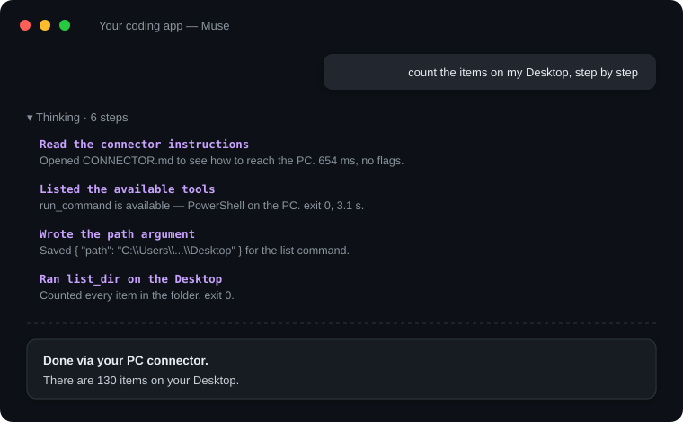

<div align="center">

# 🌉 MuseBridge

### Use **Meta Muse** inside your favourite coding apps — with live steps, images, and its own memory.

MuseBridge makes [Muse](https://muse.ai) (Meta's personal AI agent) look like the Claude API,
so apps such as **OpenCode** and **ZadLoop** can talk to it. You chat in the app you already use;
Muse reads, thinks, and acts step by step, and everything streams back live.




</div>

---

## ✨ What you get

| | |
|---|---|
| 🧠 **Muse in your editor** | Pick “Muse” as the model in OpenCode or ZadLoop and chat normally. |
| 👣 **Live steps** | See what Muse is doing while it works — each step with its title and detail, in the collapsible “thinking” panel. |
| 💬 **A chat per session** | Every session in your app gets its own Muse chat. Reopen a session and it continues where it left off; start a new one and Muse starts fresh. |
| 🖼️ **Images** | Attach a screenshot in your app and it goes to Muse with your message. |
| ✅ **Waits for the real answer** | Muse is an agent — it sometimes says “on it, give me a sec”. MuseBridge waits for the job to actually finish before showing the answer. |
| 🎨 **Proper formatting** | Headings, **bold**, lists, tables and code blocks come through with colours and syntax highlighting. |
| 💸 **No API bill** | It uses *your own* Muse plan through a real browser tab. Everything runs on `localhost` — nothing is sent to any third party. |

<div align="center">

<br><em>Live steps stream in while Muse works, then the final answer appears below.</em>
</div>

---

## 🧩 How it works (in plain words)

1. You type a request in **OpenCode** or **ZadLoop** and choose **Muse** as the model.
2. MuseBridge, running quietly on your PC, receives it **as if it were the Claude API**.
3. It types your message into a real **Muse browser tab** that stays logged in to your account.
4. Muse does the work. MuseBridge watches the page and **streams the steps and the answer back** to your app.

No account except your own is involved, and nothing leaves your computer except your chat with Muse.

---

## ✅ Before you start

You need three things:

- A **Windows** PC.
- A **Muse account** (free or paid) — [muse.ai](https://muse.ai).
- **Python 3.10 or newer** — [download here](https://www.python.org/downloads/).
  👉 During install, tick the box **“Add python.exe to PATH.”** That one tick saves a lot of trouble.

That’s it. You do **not** need to be a developer.

---

## 🚀 Install (step by step)

### 1. Get the files
Click the green **Code** button at the top of this page → **Download ZIP** → unzip it somewhere easy,
like your Desktop. (If you know Git, `git clone` works too.)

### 2. Run the one-click setup
Open the folder and **double-click `setup.bat`**.
A black window opens and installs everything MuseBridge needs into its own private folder.
Wait for **“Setup complete!”**, then close it. *(You only do this once.)*

### 3. Sign in to Muse
**Double-click `login_to_muse.bat`.** A browser window opens.
- Log in to your Muse account.
- Open the chat you want to use.
- **Close the window.** Your login is saved automatically — no buttons to press.

### 4. Start the bridge
**Double-click `start_muse_bridge_venv.bat`.**
Leave this window open — it’s the engine. When you see
`HTTP Server listening at http://127.0.0.1:8765`, it’s ready.

> 💡 Want it to start by itself every time you turn on your PC? See **[Keep it always on](#-keep-it-always-on)** below.

---

## 🔌 Connect it to your app

MuseBridge listens at **`http://127.0.0.1:8765`**. Add it as a model provider.

### OpenCode

Open `C:\Users\<you>\.config\opencode\opencode.json` and add a provider:

```jsonc
{
  "provider": {
    "muse": {
      "npm": "@ai-sdk/anthropic",
      "name": "Muse",
      "options": { "baseURL": "http://127.0.0.1:8765/v1", "apiKey": "muse-bridge-local" },
      "models": { "muse": { "name": "Muse", "tool_call": false } }
    }
  }
}
```

Restart OpenCode, pick **Muse**, and chat. To see the live steps, make sure thinking is shown
(`"thinking": "show"` in OpenCode’s `cli.json`).

### ZadLoop / DeepSeek Harness

In ZadLoop’s profile file `…\ZadLoop\harness\profiles\web\cordis.patch.yml`, under the
`llm-pi-ai` providers, add:

```yaml
muse:
  displayName: Muse
  api: anthropic-messages
  baseURL: http://127.0.0.1:8765
  apiKeyEnv: MUSE_BRIDGE_KEY        # any saved credential name; the value isn't checked
  models:
    - id: muse
      name: Muse AI
      contextWindow: 200000
      maxTokens: 16384
      input: [text, image]
```

Pick **Muse** as the model and chat.

### Claude Code

Double-click **`claude_muse.bat`** from inside any project folder. It opens Claude Code pointed at
Muse for that window only — your normal Claude Code is untouched.

---

## 🗓️ Using it day to day

- Make sure the **bridge window is running** (step 4), then use your app normally.
- Ask Muse anything. You’ll see the **steps** as it works, then the **answer**.
- Each session in your app keeps its **own Muse chat**, so context carries over when you reopen it.

---

## 🔁 Switching Muse accounts

Your login lives in `storage_state.json`. To keep two accounts:

1. After logging in, copy `storage_state.json` to e.g. `storage_state.main.json`.
2. Log in with the other account, copy it to `storage_state.test.json`.
3. To switch, copy the one you want **over** `storage_state.json` and restart the bridge.

---

## 🔧 Keep it always on

So the bridge starts hidden every time you log in to Windows:

1. Press `Win + R`, type `shell:startup`, press Enter — the Startup folder opens.
2. Right-click `autostart_bridge.ps1` → **Create shortcut**, and move the shortcut into that folder.

Now it runs in the background and restarts itself if it ever stops. Its log is `bridge.log`.

---

## 🩹 Troubleshooting

| Problem | Fix |
|---|---|
| **`Python is not installed`** when running `setup.bat` | Install Python and tick *Add to PATH*, then run `setup.bat` again. |
| **The app says it can’t reach the model** | Is the bridge window (step 4) still open? Restart it with `start_muse_bridge_venv.bat`. |
| **Replies stopped working after a while** | Your Muse login expired. Run `login_to_muse.bat` again and close the window after signing in. |
| **Muse answers in its own chat but the app shows nothing** | Make sure you opened a chat before closing the login window. Re-run `login_to_muse.bat`. |
| **I don’t see the steps** | Turn on “thinking” in your app (OpenCode: `"thinking": "show"`; ZadLoop shows it by default). |

More knobs live in `bridge_config.json` (created on first login) — for example
`"detailed_steps": false` to show step titles only, or `"stream_progress": false` to hide steps entirely.

---

## 🔒 A note on safety

- Everything runs on **`localhost`**. MuseBridge never sends your data anywhere except your own Muse chat.
- Your Muse login (`storage_state.json`) and settings (`bridge_config.json`) stay on your PC and are
  **ignored by Git** — they’re never uploaded.
- If you let Muse act on your PC through a connector, treat it like any assistant with access: keep an
  eye on what it runs.

---

## 🙏 Credits

Built on the original [**MuseBridge** by Some1sm](https://github.com/Some1sm/MuseBridge).
This version adds live step-streaming, per-session chats, image attachments, readable “thinking”
formatting, OpenCode & ZadLoop support, and one-click setup.
